# Psion Sidecar

Psion Sidecar is a lightweight Python web application that provides a Psion-friendly homepage and access to online services from a Psion Series 5mx, Series 7 or other compatible EPOC device.

The same Sidecar application can be hosted on a **Raspberry Pi** or an **Android device running Termux**. It brings together:

- Psion Community software browsing and downloads.
- Local EPOC16 and EPOC32 software catalogue searches.
- Psion-friendly search pages, news feeds and useful web resources.
- Guardian Quick and Cryptic crossword downloads.
- Original crossword files and conversion to RMR / FatCatz format.
- A local archive of previously downloaded crosswords.

The host device runs the web server and connects to the external services used by the project. The Psion accesses Sidecar using a compatible browser such as Opera or PsiWeb. Sidecar can also be opened from another computer or browser. The first software search may take a little longer while the local cache is created.

The crossword downloader, `guardian_pi.py`, can also be run independently on any suitable computer with Python, without running the web server. Downloaded files can be converted using the Python converter, `crossword_converter.py`, or transferred to the Psion and converted there using the separate OPL program, `crossword_converter_v01.txt`. When Sidecar is running, crossword downloading and conversion are integrated into the web interface.

Thanks to Kian (https://www.kianryan.co.uk), Daniel (https://github.com/danieledge), Jason (https://github.com/jbmorley), and Tom (https://github.com/tomsci), whose work on connectivity and software aggregation inspired me to get this project moving. I initially used Kian's Sidecar settings for Modem/Comms and subsequently adopted Daniel's M5Atom PsiTerm suite implementation for network access because I like the minimalist hardware execution that the M5Atom offers.

Rather than modify Daniel's own M5Atom firmware locally, I chose to add a separate Sidecar host to my home network. My original Raspberry Pi also displays shared calendars and 2Do lists on an e-Ink screen, so it made sense to use it to host a Psion "home page" as well. This gives the Psion access to Psion Community software, news and search resources, and Guardian crosswords.

An important motivation has been to make the Psion software archive practical to search from older hardware. Sidecar searches compact local catalogue indexes on the host and returns Psion-friendly results. The Psion does not need to download or search the large repository catalogues itself; it downloads only the program files it selects.

## Hosting platforms and architecture

Sidecar uses a common application codebase on both hosting platforms. The web interface, crossword downloader, converter and software catalogue are shared. Installation, service management and updating are platform-specific.

| Deployment | How Sidecar runs | Installation and update guidance |
|---|---|---|
| Raspberry Pi (standalone) | A systemd service, typically installed under `/opt/psion-sidecar`. | [Raspberry Pi installation](docs/INSTALL.md). The repository includes `scripts/update-psion-sidecar` for the documented standard installation. |
| Raspberry Pi alongside InkyPi | Sidecar runs as its own systemd service alongside the separate InkyPi application. | This is a deployment arrangement, not a separate Sidecar application. Keep the InkyPi service and configuration independent; back up and update the Sidecar checkout and restart only its service. |
| Android with Termux | A runit service managed by `termux-services`. | [Android / Termux installation](docs/TERMUX-INSTALL.md), including the Termux installer and updater scripts. |

The InkyPi arrangement allows one Raspberry Pi to host Sidecar while continuing to run InkyPi for an e-Ink display. The two applications have separate services: updating or restarting Sidecar does not require changing the InkyPi application or its service.

## Updating

Use the update procedure for the hosting platform:

- **Standard Raspberry Pi installation:** follow [the Raspberry Pi updater instructions](docs/INSTALL.md#5-optional-install-the-updater). The supplied updater stages the latest GitHub `main`, backs up the installed application files, installs them and checks the web server.
- **Android / Termux:** use `scripts/update-termux-sidecar` as described in [the Termux update instructions](docs/TERMUX-INSTALL.md#7-update-an-installed-instance). The updater targets one selected Termux service and leaves other instances and their service definitions alone.
- **Custom Raspberry Pi arrangements, including InkyPi deployments:** first back up the Sidecar application and its crossword archive. Check that the Git working tree is clean, update the Sidecar checkout, compile-check the Python files, and restart only the Sidecar systemd service. Do not replace or restart the separate InkyPi application or service.

After any update, check the Sidecar service status and open its homepage. Then test the software catalogue and crossword download workflow. A successful HTTP health check alone does not prove that external searches or downloads work.

## What's included

- A Psion Community software catalogue interface, including filtered program searches and download links.
- Psion-friendly web resources, including access to FrogFind.
- Example service definitions for Raspberry Pi (systemd) and Android / Termux (runit).
- Guardian Quick and Cryptic crossword download requests.
- Direct downloads of original Guardian crossword text files.
- On-demand conversion of downloaded crosswords to RMR / FatCatz format on the hosting device.
- A local crossword archive with links to both original and RMR-converted files.
- A separate Psion-side OPL conversion workflow for users who prefer to convert crossword files on the Psion.

The project has been developed and tested on Raspberry Pi OS and Android using Termux. The Sidecar web server uses Python's standard library and does not require third-party Python packages.

A Raspberry Pi or an Android device running Termux can host the browser-based Sidecar. A suitable computer with Python can also run the standalone crossword downloader.

## Status and limitations

This is a community project provided as-is. The Guardian website, FrogFind and external software archives can change independently of this code. Downloading, searching and catalogue browsing therefore depend on those external services remaining compatible and accessible. A Python script is provided to update the local indexes from the Psion Community source.

The Sidecar web interface is designed for simple, text-oriented browsing on older Psion devices. Features and external services may change over time. The RMR conversion workflow has been tested for successful file generation and download; compatibility with individual Psion crossword applications should be verified on the target device.

## Psion Community software Sidecar downloader

Selecting the Psion Community software link on the Sidecar homepage opens a search interface where you can filter for EPOC16/EPOC32 software and then search the software catalogue and access available downloads for matching software ready for download.

The catalogue uses three JSON index files in the project directory:

- `epoc16_index.json` — EPOC16 software index.
- `epoc32_index.json` — EPOC32 software index.
- `software_index.json` — main software catalogue index.

All three index files are included in the repository. At the current count, the index contains 4,880 programs.

To refresh all three files from the Psion Community API, run this from the repository directory on a computer with Python 3 and internet access:

```bash
python3 update_software_indexes.py
python3 -m unittest discover -s tests -v
```

The updater validates the API response before writing anything, preserves the full upstream records (including versions, variants and download references) in `software_index.json`, and regenerates the compact EPOC16/EPOC32 search indexes. Review the reported counts and file changes, then commit and push the updated JSON files. The script does not change Sidecar's selection or download-handling code.

## Downloading software

Where a complete archive or package is available, Sidecar presents a **complete-package ZIP download**, which is the recommended option. This can be particularly important when the software consists of multiple files.

Individual downloads are also available when supported by the catalogue entry. Depending on the entry, these may include `.SIS` installer packages or individual `.APP` and `.OPA` files.

The available download options depend on the software archive and the links recorded in the catalogue.

For individual program-file references, Sidecar applies a size rule: a direct link is displayed only when the file size is known and no greater than 10 MB. Larger files and files of unknown size (e.g., to an ISO) may remain visible as references but without a direct link.

## Saving downloads on a Psion

When downloading through a Psion browser, the transfer may initially use a generic filename such as `Download.bin`. Wait for the transfer to finish and follow the browser's prompts to save the file.

If an individual download is saved with a `.bin` extension rather than its original extension, you may need to rename it before using it. A ZIP package can usually be extracted with RMRZip/Unzip.

Please respect the provenance, copyright and redistribution terms of the indexed material and any linked software packages. Inclusion of catalogue indexes or download links does not grant permission to redistribute the software they describe.

## Guardian Quick and Cryptic crossword downloads

There are two main ways to download Guardian Quick and Cryptic crosswords for use on the Psion.

- **Standalone downloader:** Run `guardian_pi.py` directly on a suitable PC or Raspberry Pi to download and save a crossword text file.
- **Sidecar downloader:** Request a crossword through the Sidecar web interface on the Raspberry Pi or Android host. Sidecar offers the original crossword and an RMR-format version generated by `crossword_converter.py`.

The Python converter can also be used separately. Alternatively, the original crossword can be transferred to the Psion and converted using the OPL conversion program described below.

## Guardian crossword standalone downloader: `guardian_pi.py`

Menu options:
1	Download one crossword
2	Download a batch of crosswords
3	Download today's crossword
4	Exit

The downloader currently records these Guardian archive limits in `guardian_pi.py`:

- Quick: 9,093–17,583
- Cryptic: 21,620–30,109

These values were last recorded as checked on 12 September 2026. They are archive limits stored in the source code, not a guarantee that every number is available or that the upper limits represent the latest published crosswords. The "today's crossword" option checks the Guardian for the latest number.

Before downloading, the program checks whether the crossword is already available locally and whether it is present in the Guardian's own archive. If a download is appropriate, it retrieves the puzzle and saves the resulting text file in the output directory.

Example filenames include:

```text
Quick_17028.txt
Cryptic_30103.txt
```

To download a Quick crossword by number, specifying an output directory, run:

```bash
python guardian_pi.py quick 17028 /home/pi/crosswords
```

If no output directory is specified, the program uses its configured default.

## How crosswords are retrieved

The downloader uses the Guardian's accessible crossword pages, e.g.:

<https://www.theguardian.com/crosswords/accessible/quick/10271>

It retrieves the Guardian's webpage and extracts the structured JSON embedded in it, rather than depending on a separate API endpoint.

The standalone downloader includes compatibility code for Python 2.7 and Python 3, although Python 3 is recommended. The browser-based web server requires Python 3.

## Guardian crossword Sidecar downloader

The Sidecar web interface uses `guardian_pi.py` to process crossword download requests and presents the results through a browser.

After a successful request, the page provides links to save the original crossword or download an RMR-format version generated on the Sidecar host.

The archive lists previously downloaded Quick and Cryptic crosswords stored in the project's `crosswords/` directory on the hosting device. Each archived crossword provides separate links to the original file and its RMR-converted version.

Converted files are stored on the hosting device and can be downloaded directly to a compatible Psion browser. The conversion output is cached and regenerated if the original crossword is newer than the converted file.

## Importing Guardian crosswords into RMR / FatCatz Crossword

Sidecar provides two ways to prepare a Guardian crossword:

- **Direct RMR download:** Select **Download RMR version** in Sidecar. The Sidecar host converts the original crossword into RMR format and serves the converted file for download, allowing you to save it directly to the Psion.
- **Psion-side conversion:** Download the original crossword and use the separate `crossword_converter_v01.txt` OPL program to convert it on the Psion.

## Converting a crossword on the Psion

To convert a crossword on the Psion, rather than using Sidecar's Python converter:

1. Transfer the original Guardian crossword text file to the Psion.
2. Import `crossword_converter_v01.txt` into the Psion OPL environment and save it as an `.opl` program.
3. Run the program and use its file browser to select the downloaded crossword.
4. Follow the program's prompts to convert the file. Choose whether to delete the original file as appropriate.
5. Open RMR / FatCatz Crossword and use **File → Open** to select the converted crossword.

This OPL workflow is separate from the Python conversion performed by Sidecar.

## Quick start: installing the browser-based Sidecar

Clone the repository and enter the project directory:

```bash
git clone https://github.com/Shredder61/Psion-sidecar.git
cd Psion-sidecar
```

Check your Python version and compile-check the scripts:

```bash
python3 --version
python3 -m py_compile sidecar_web.py guardian_pi.py crossword_converter.py
```

For a quick foreground test on either platform, start the server using the default port (8081):

```bash
python3 sidecar_web.py
```

To use a different port, for example 8082:

```bash
python3 sidecar_web.py --port 8082
```

From a device on the same network, open:

```text
http://<host-address>:8081/
```

Replace `<host-address>` with the hostname or IP address of the device running Sidecar (Raspberry Pi or Android device).

If you started the server using port 8082, use `8082` instead of `8081` in the address.

Stop the foreground server with `Ctrl+C`.

The server listens on `0.0.0.0` on port `8081` by default. Use `--port PORT` to select another port; the chosen port must also be used in the browser URL and any service configuration. Do not expose the server directly to the public internet without appropriate security controls.

## Features of the Sidecar homepage

- Guardian Quick and Cryptic crossword download requests.
- Access to locally stored crossword files.
- Psion Community software catalogue and download links, when the required index data is available.
- FrogFind search access through the Sidecar host.

## Screenshots

These screenshots illustrate the Sidecar homepage, the Psion Community software catalogue, and the Guardian crossword workflow on a Psion.

### Sidecar homepage

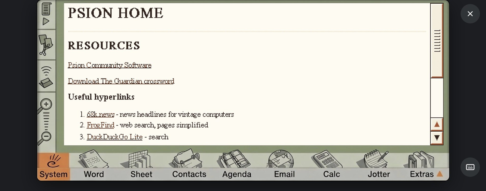

### Psion Community software catalogue

Search the catalogue and filter results by platform or program name.

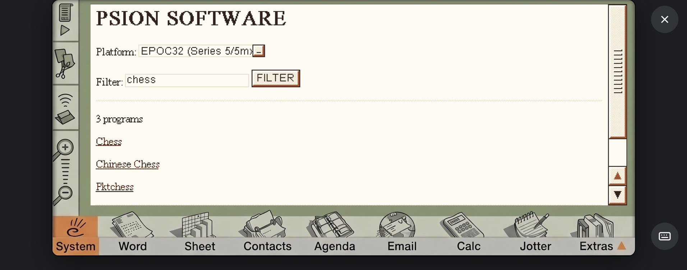

Review a program's available downloads, download a package, and install it on the Psion.

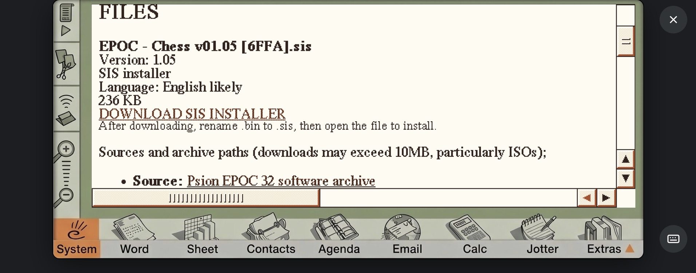

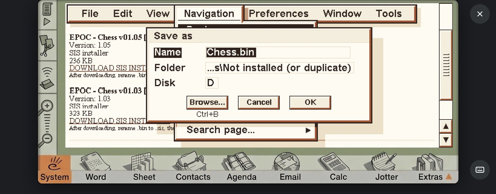

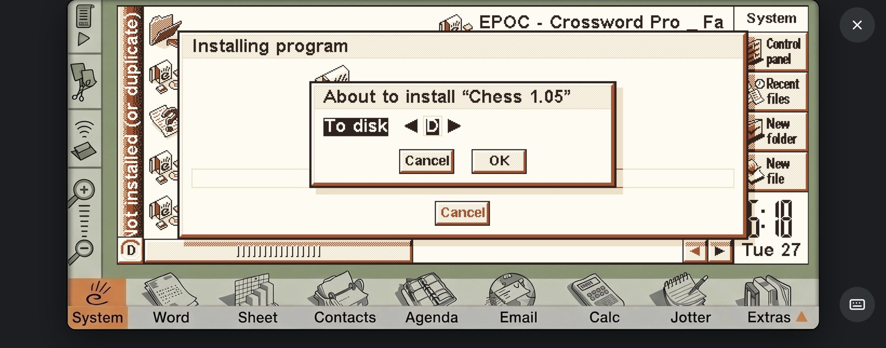

The program details page shows both the recommended complete ZIP package and the individual SIS installer. Note that the program package might include other essential program files or even just the readme.txt file, so where available, the .ZIP file is the recommended choice.

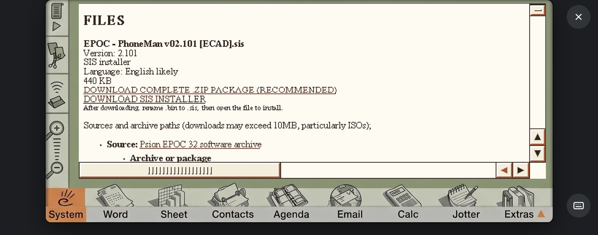

Using RMR Zip/Unzip to extract the .ZIP package.

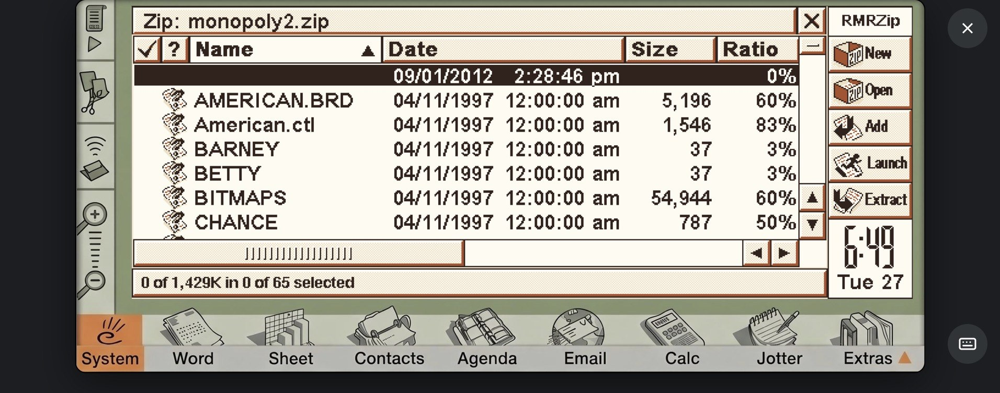

### Guardian crossword workflow

Browse the local crossword archive, request a crossword, and download the original or converted RMR version.


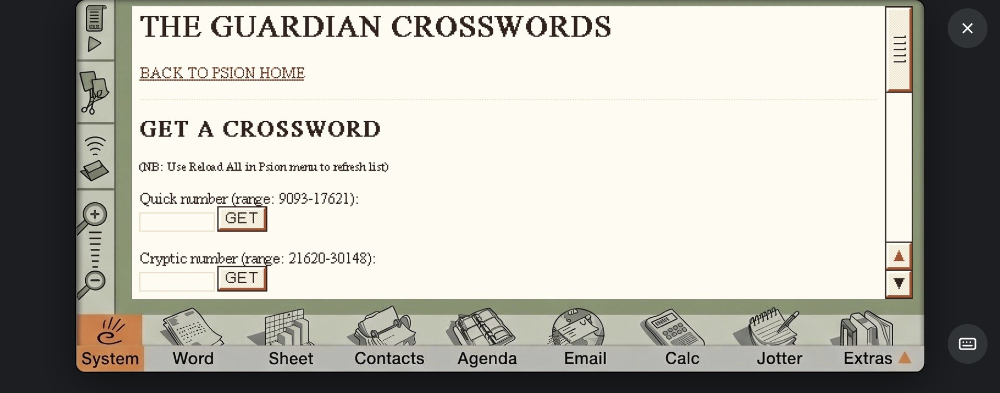

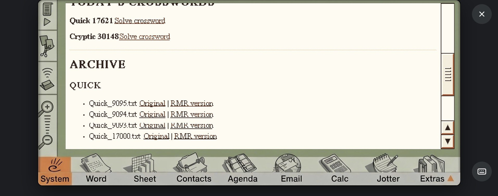

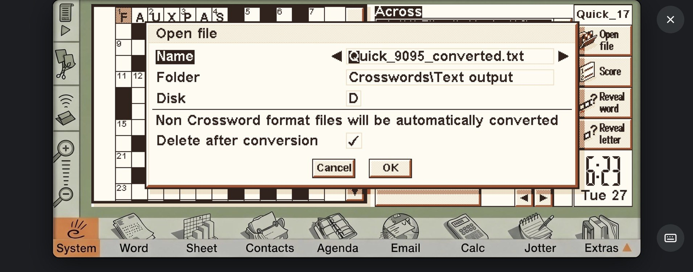

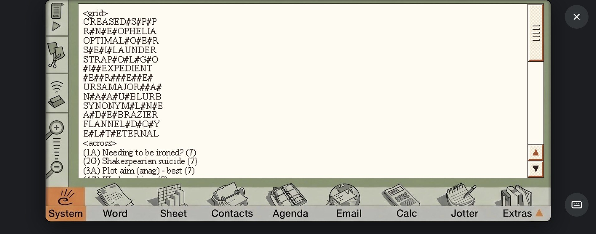

Open the converted file in RMR / FatCatz Crossword and save it in the desired folder.

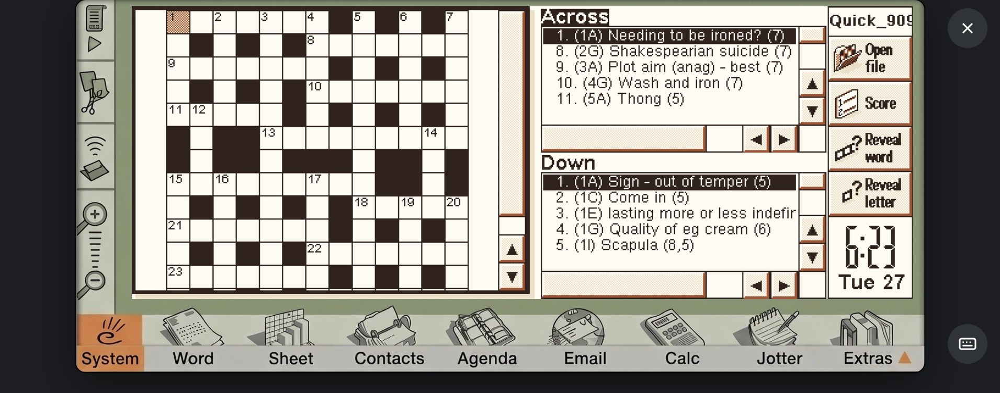

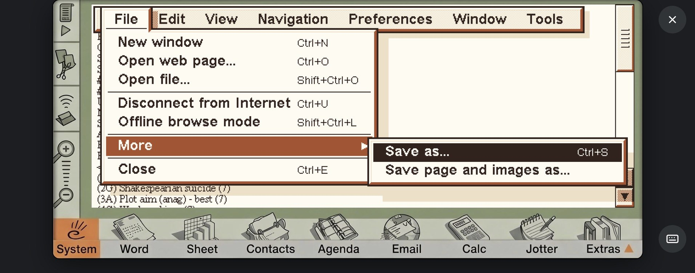

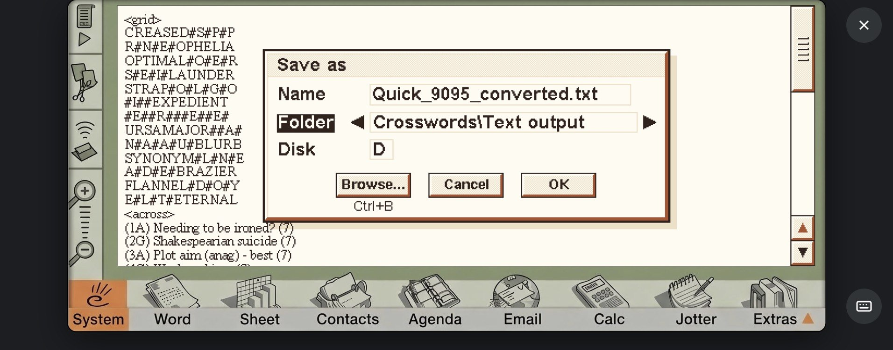

## Installation as a service

- [Raspberry Pi installation](docs/INSTALL.md) — installation and configuration as a systemd service.
- [Android / Termux installation](docs/TERMUX-INSTALL.md) — installation and configuration as a runit service.

For step-by-step instructions on accessing Sidecar from a Psion, searching the software catalogue, and downloading software or crosswords, see [Using Sidecar from a Psion](docs/PSION-SETUP.md).

## Project files

- `sidecar_web.py` — Sidecar web server and browser interface.
- `guardian_pi.py` — Guardian crossword downloader.
- `crossword_converter.py` — Python converter for producing RMR-format crossword files.
- `crossword_converter_v01.txt` — OPL conversion program for use on the Psion.
- `systemd/psion-sidecar.service` — example Raspberry Pi systemd service.
- `scripts/update-psion-sidecar` — updater for the documented standard Raspberry Pi installation.
- `scripts/install-termux.sh` — Android / Termux installer.
- `scripts/update-termux-sidecar` — Android / Termux updater.
- `termux/services/psion-sidecar/run` — example Termux runit service.
- `crosswords/` — local crossword storage, including original and converted files.
- `docs/` — installation and usage notes.
- `epoc16_index.json` — EPOC16 software index.
- `epoc32_index.json` — EPOC32 software index.
- `software_index.json` — main software catalogue index.

## Copyright, permissions and external services

This repository does not grant rights to Guardian crossword content, FrogFind, Psion software packages or third-party catalogue data. Respect the copyright, terms of use and redistribution conditions of each external service and file source.

No project software licence has been selected for this release. Until an appropriate licence is added, do not assume that the code is offered under an open-source licence or that permission to reuse, modify or redistribute it has been granted.
