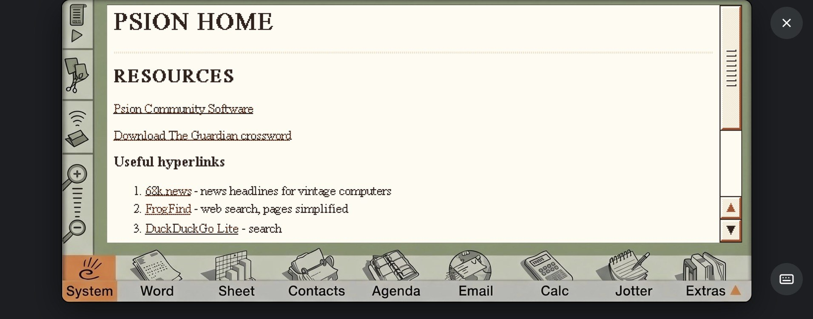
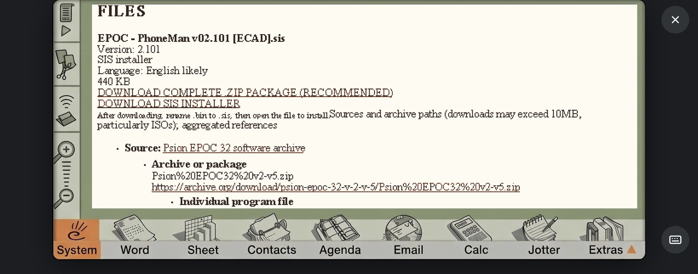

# Psion Sidecar

Psion Sidecar is a small Python web server that provides a Psion-friendly homepage hosted on a Raspberry Pi. It brings together access to the Psion Community software browsing, Psion-friendly search pages and news feeds, and Guardian crossword downloads (native or RMR / FatCatz format), all to download and access from the Psion. 

The Sidecar can be accessed using a compatible browser such as Opera or PsiWeb or you can access it from any other computer. The Raspberry Pi provides the web server and connects to the external services used by the project. Note that, when searching for Psion software, the first program search may take a little longer while the local cache is created. 

The crossword downloader, `guardian_pi.py`, can also be run independently on any suitable computer with Python so you can download crosswords without running the web server. You can then convert the downloaded files using the Python converter, `crossword_converter.py`, or transfer them to the Psion and use the separate OPL program, `crossword_converter_v01.txt`. However, with the Raspberry Pi implementation, all of this is integrated.

Thanks to Kian (https://www.kianryan.co.uk), Daniel (https://github.com/danieledge), Jason (https://github.com/jbmorley), and Tom (https://github.com/tomsci) whose work on connectivity and software aggregation inspired me to get this project moving. In my situation, I used Kian's sidecar settings for the Modem/Comms and now use Daniel's M5Atom PsiTerm suite implementation for network access because I like the minimalist hardware execution that the M5Atom offers. 

However, respecting Daniel's own firmware on the M5Atom (i.e., to not change it locally), I choose to add a separate Raspberry Pi on my network (which also displays shared calendars and 2Do lists on an e-Ink screen) to host a Psion "Home page". This gives the Psion access to the Psion Community software hyperlinks, news/search hyperlinks, and The Guardian crossword puzzles. Importantly, and a main driver for doing this work, is that the Psion searches the Pi's local software catalogue using compressed local indexes and hence does not need to commit large data downloads from the repositories, other for the program files themselves, which are usually quite small.

## What's included

- A Psion Community software catalogue interface, including filtered program searches and download links.
- Psion-friendly web resources, including access to FrogFind.
- An example systemd service for starting the server automatically when the Raspberry Pi boots.
- Guardian Quick and Cryptic crossword download requests.
- Direct downloads of original Guardian crossword text files.
- On-demand conversion of downloaded crosswords to RMR / FatCatz format on the Raspberry Pi.
- A local crossword archive with links to both original and RMR-converted files.
- A separate Psion-side OPL conversion workflow for users who prefer to convert crossword files on the Psion.

The project was developed and tested on Raspberry Pi OS with Python 3.13. The Sidecar web server uses Python's standard library and does not require third-party Python packages.

A Raspberry Pi is required to host the browser-based Sidecar, but it is not necessary if you only want to run the standalone crossword downloader.

## Status and limitations

This is a community project provided as-is. The Guardian website, FrogFind and external software archives can change independently of this code. Downloading, searching and catalogue browsing therefore depend on those external services remaining compatible and accessible.

The Sidecar web interface is designed for simple, text-oriented browsing on older Psion devices. Features and external services may change over time. The RMR conversion workflow has been tested for successful file generation and download; compatibility with individual Psion crossword applications should be verified on the target device.

## Psion Community software Sidecar downloader

Selecting the Psion Community software link on the Sidecar homepage opens a search interface where you can filter for EPOC16/EPOC32 software and then search the software catalogue and access available downloads for matching software ready for download.

The catalogue uses three JSON index files in the project directory:

- `epoc16_index.json` — EPOC16 software index.
- `epoc32_index.json` — EPOC32 software index.
- `software_index.json` — main software catalogue index.

All three index files are included in the repository and should be kept up to date. At the current count, the index contains 4,880 programs.

## Downloading software

Where a complete archive or package is available, Sidecar presents a **complete-package ZIP download**, which is the recommended option. This can be particularly important when the software consists of multiple files.

Individual downloads are also available when supported by the catalogue entry. Depending on the entry, these may include `.SIS` installer packages or individual `.APP` and `.OPA` files.

The available download options depend on the software archive and the links recorded in the catalogue.

For individual program-file references, Sidecar applies a size rule: a direct link is displayed only when the file size is known and no greater than 10 MB. Larger files and files of unknown size (e.g., to an ISO) may remain visible as references but without a direct link.

## Saving downloads on a Psion

When downloading through a Psion browser, the transfer may initially use a generic filename such as `Download.bin`. Wait for the transfer to finish and follow the browser's prompts to save the file.

If an individual download is saved with a `.bin` extension rather than its original extension, you may need to rename it before using it. A ZIP package can usually be extracted with RMRZip/Unzip.

Please respect the provenance, copyright and redistribution terms of the indexed material and any linked software packages. Inclusion of catalogue indexes or download links does not grant permission to redistribute the software they describe.

## Guardian Quick and Cryptic crossword downloads

There are two main ways to download Guardian Quick and Cryptic crosswords for use on the Psion.

- **Standalone downloader:** Run `guardian_pi.py` directly on a suitable PC or Raspberry Pi to download and save a crossword text file.
- **Sidecar downloader:** Request a crossword through the Raspberry Pi's web interface. Sidecar offers the original crossword and an RMR-format version generated by `crossword_converter.py`.

The Python converter can also be used separately. Alternatively, the original crossword can be transferred to the Psion and converted using the OPL conversion program described below.

## Guardian crossword standalone downloader: `guardian_pi.py`

Menu options:
1	Download one crossword
2	Download a batch of crosswords
3	Download today's crossword
4	Exit

The downloader currently records these Guardian archive limits in `guardian_pi.py`:

- Quick: 9,093–17,583
- Cryptic: 21,620–30,109

These values were last recorded as checked on 12 September 2026. They are archive limits stored in the source code, not a guarantee that every number is available or that the upper limits represent the latest published crosswords. The "today's crossword" option checks the Guardian for the latest number.

Before downloading, the program checks whether the crossword is already available locally and whether it is present in the Guardian's own archive. If a download is appropriate, it retrieves the puzzle and saves the resulting text file in the output directory.

Example filenames include:

```text
Quick_17028.txt
Cryptic_30103.txt
```

To download a Quick crossword by number, specifying an output directory, run:

```bash
python guardian_pi.py quick 17028 /home/pi/crosswords
```

If no output directory is specified, the program uses its configured default.

## How crosswords are retrieved

The downloader uses the Guardian's accessible crossword pages:

<https://www.theguardian.com/crosswords/accessible/>

It deliberately uses these pages rather than the Guardian's JSON/API interface.

The standalone downloader includes compatibility code for Python 2.7 and Python 3, although Python 3 is recommended. The browser-based web server requires Python 3.

## Guardian crossword Sidecar downloader

The Sidecar web interface uses `guardian_pi.py` to process crossword download requests and presents the results through a browser.

After a successful request, the page provides links to save the original crossword or download an RMR-format version generated on the Raspberry Pi.

The archive lists previously downloaded Quick and Cryptic crosswords stored in the project's `crosswords/` directory. Each archived crossword provides separate links to the original file and its RMR-converted version.

Converted files are stored on the Raspberry Pi and can be downloaded directly to a compatible Psion browser. The conversion output is cached and regenerated if the original crossword is newer than the converted file.

## Importing Guardian crosswords into RMR / FatCatz Crossword

Sidecar provides two ways to prepare a Guardian crossword:

- **Direct RMR download:** Select **Download RMR version** in Sidecar. The Raspberry Pi converts the original crossword into RMR format and serves the converted file for download, allowing you to save it directly to the Psion.
- **Psion-side conversion:** Download the original crossword and use the separate `crossword_converter_v01.txt` OPL program to convert it on the Psion.

## Converting a crossword on the Psion

To convert a crossword on the Psion, rather than using Sidecar's Python converter:

1. Transfer the original Guardian crossword text file to the Psion.
2. Import `crossword_converter_v01.txt` into the Psion OPL environment and save it as an `.opl` program.
3. Run the program and use its file browser to select the downloaded crossword.
4. Follow the program's prompts to convert the file. Choose whether to delete the original file as appropriate.
5. Open RMR / FatCatz Crossword and use **File → Open** to select the converted crossword.

This OPL workflow is separate from the Python conversion performed by Sidecar.

## Quick start: installing the browser-based Sidecar

Clone the repository and enter the project directory:

```bash
git clone https://github.com/Shredder61/Psion-sidecar.git
cd Psion-sidecar
```

Check your Python version and compile-check the scripts:

```bash
python3 --version
python3 -m py_compile sidecar_web.py guardian_pi.py crossword_converter.py
```

Start the server in the foreground:

```bash
python3 sidecar_web.py
```

From a device on the same network, open:

```text
http://<raspberry-pi-address>:8081/
```

Replace `<raspberry-pi-address>` with the hostname or IP address of your Raspberry Pi.

Stop the foreground server with `Ctrl+C`.

The server listens on `0.0.0.0` on port `8081` by default. Do not expose this port directly to the public internet without appropriate security controls.

## Features of the Sidecar homepage

- Guardian Quick and Cryptic crossword download requests.
- Access to locally stored crossword files.
- Psion Community software catalogue and download links, when the required index data is available.
- FrogFind search access through the Pi.

## Screenshots

These screenshots illustrate the Sidecar homepage, the Psion Community software catalogue, and the Guardian crossword workflow on a Psion.

### Sidecar homepage



### Psion Community software catalogue

Search the catalogue and filter results by platform or program name.


Review a program's available downloads, download a package, and install it on the Psion.


The program details page shows both the recommended complete ZIP package and the individual SIS installer.




### Guardian crossword workflow

Browse the local crossword archive, request a crossword, and download the original or converted RMR version.


Open the converted file in RMR / FatCatz Crossword and save it in the desired folder.


## Installation as a service

See [docs/INSTALL.md](docs/INSTALL.md) for instructions on installing the server as a systemd service.

For step-by-step instructions on accessing Sidecar from a Psion, searching the software catalogue, and downloading software or crosswords, see [Using Sidecar from a Psion](docs/PSION-SETUP.md).

## Project files

- `sidecar_web.py` — Sidecar web server and browser interface.
- `guardian_pi.py` — Guardian crossword downloader.
- `crossword_converter.py` — Python converter for producing RMR-format crossword files.
- `crossword_converter_v01.txt` — OPL conversion program for use on the Psion.
- `systemd/psion-sidecar.service` — example systemd service.
- `crosswords/` — local crossword storage, including original and converted files.
- `docs/` — installation and usage notes.
- `epoc16_index.json` — EPOC16 software index.
- `epoc32_index.json` — EPOC32 software index.
- `software_index.json` — main software catalogue index.

## Copyright, permissions and external services

This repository does not grant rights to Guardian crossword content, FrogFind, Psion software packages or third-party catalogue data. Respect the copyright, terms of use and redistribution conditions of each external service and file source.

No project software licence has been selected for this release. Until an appropriate licence is added, do not assume that the code is offered under an open-source licence or that permission to reuse, modify or redistribute it has been granted.
