# Using Sidecar from a Psion

This guide covers using the Sidecar from a Psion browser: opening the homepage,
searching the Psion Community software catalogue, downloading software, and
getting Guardian crosswords into a compatible crossword application.

## 1. Open the Sidecar homepage

1. Start Sidecar on the device hosting it (Raspberry Pi or Android).
2. Connect the Psion to the same network, or establish your usual supported
   connection to the device hosting Sidecar.
3. Open Opera or another compatible browser on the Psion.
4. Enter `http://<host-address>:8081/`, replacing the placeholder with
   the hostname or IP address of the device hosting Sidecar.

The Sidecar server must be running, and the Psion must have a working connection
to it. The URL must use the port configured for the server; this is `8081` by
default, but it may be different if the server was started with `--port`.

## 2. Browse files on the Sidecar

Use the homepage links to browse locally stored crossword files and other
available resources.

## 3. Search the Psion Community software catalogue

1. Select the Psion Community software link on the Sidecar homepage.
2. Choose the platform that matches the software you need: **EPOC16** or
   **EPOC32**. These are separate catalogue indexes, so check the platform
   before searching.

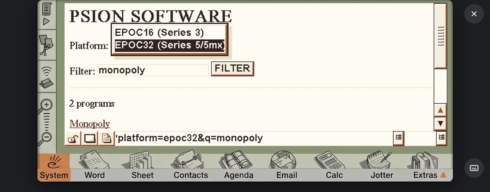

3. Enter part or all of the program name in the search/filter field. For
   example, search for `Phoneman` to find this software.
4. Review the matching results and select the program you want.

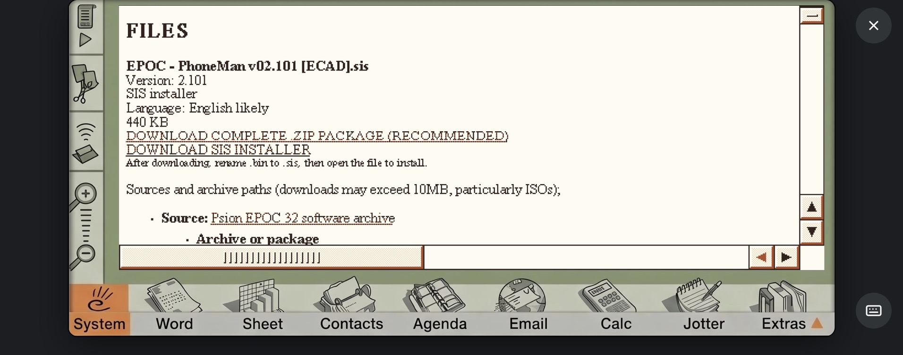

5. Check the available downloads and choose the appropriate package. Where a
   complete-package ZIP is offered, it is generally the best choice for
   software made up of several files. Individual `.SIS`, `.APP` or `.OPA`
   downloads may also be available, depending on the catalogue entry.
6. Follow the browser's prompts and wait for the download to finish.

The example below shows a search for chess programs with EPOC32 selected. The platform selector
lets you switch between EPOC16 and EPOC32 before searching.

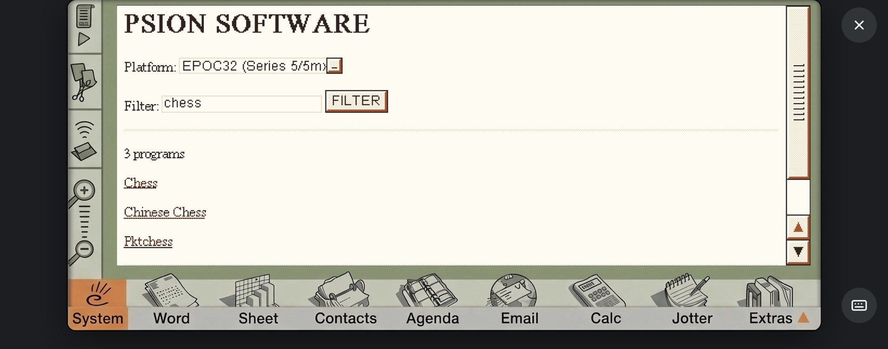

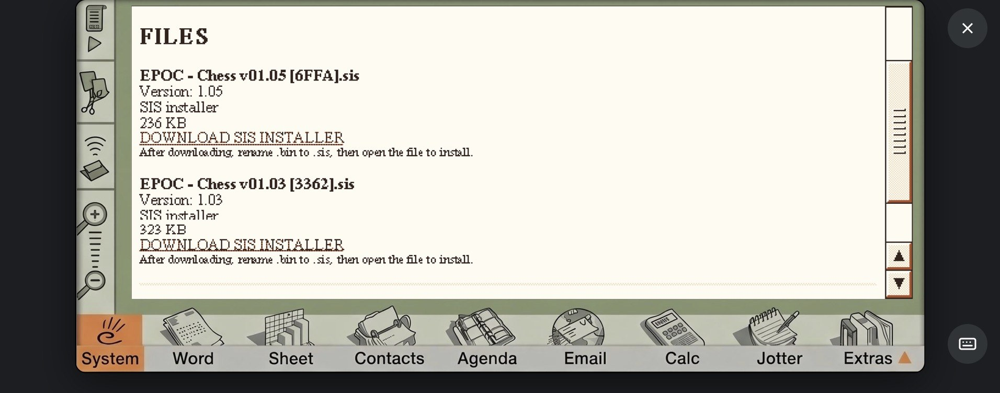

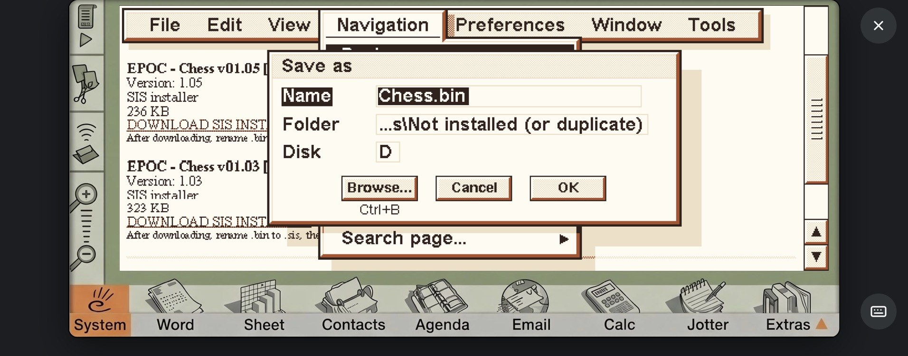

### Saving and installing software

The browser may initially use a generic filename such as `Download.bin`.
Follow the save prompt and check the resulting filename before attempting to
install the package. If an individual download is saved with a `.bin`
extension rather than its original extension, you may need to rename it.

A ZIP package may need to be extracted (e.g., RMR Unzip) before its contents 
can be installed on the Psion.

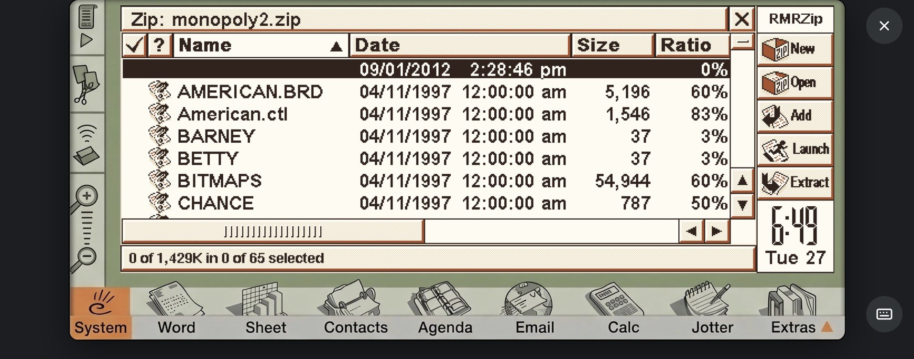

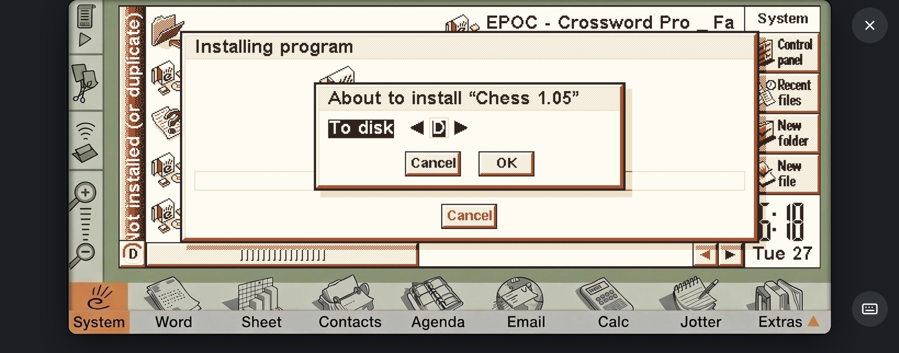

Software availability depends on the external archive and the links recorded
in the catalogue. Respect the copyright and redistribution terms for any
software you download.

## 4. Download a Guardian crossword

1. On the Sidecar homepage, choose the Guardian crossword link.
2. Enter the Quick or Cryptic crossword number and submit the request.
3. Sidecar fetches the Guardian puzzle, converts it in memory and saves a
   standard Across Lite `.puz` file on the host.
4. Select **DOWNLOAD ACROSS LITE PUZZLE (.PUZ)** and follow the browser's
   prompts to save the file on the Psion. The local archive also lists
   previously downloaded PUZ files.

Example filenames include `Quick_17028.puz` and `Cryptic_30103.puz`.

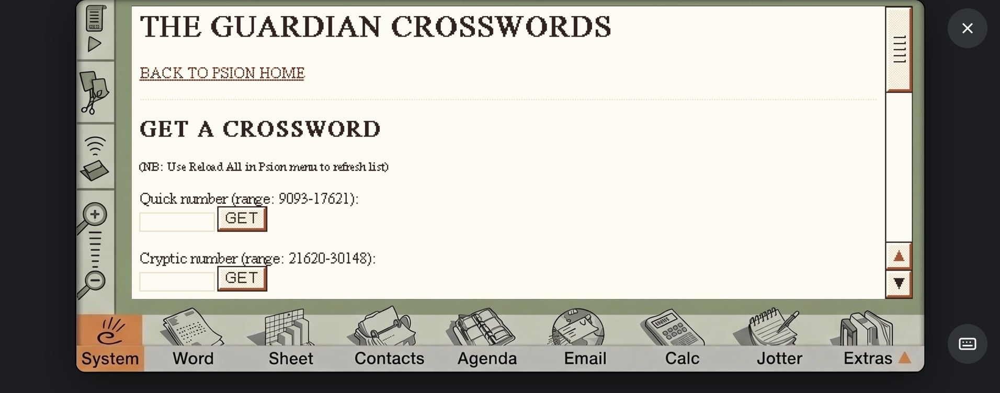

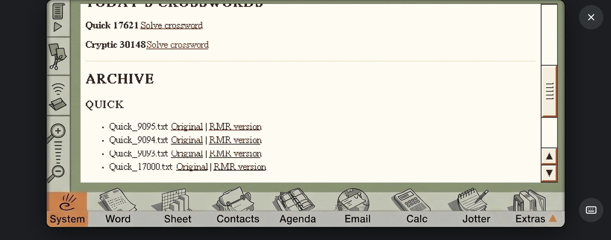

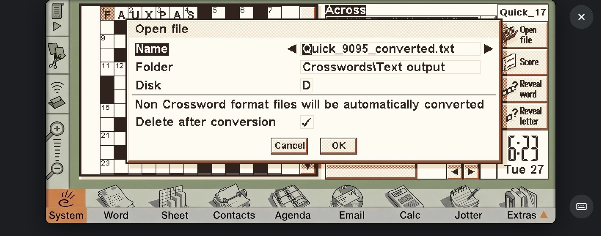

## 5. Open the crossword

Open the downloaded `.puz` file in RMR Crossword or FatCatz Crossword. Use
the application's **File → Open** command and browse to the folder where
you saved it.

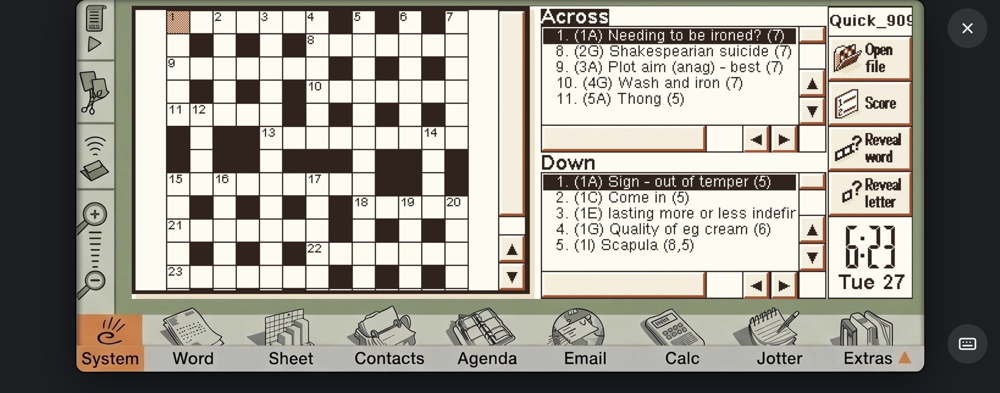

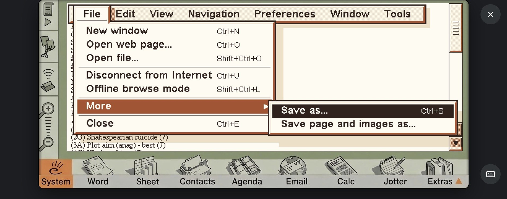

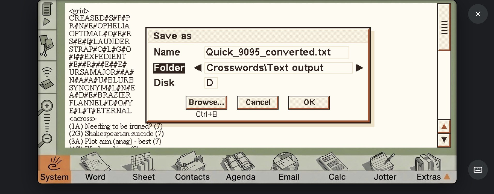

## Notes

- The Sidecar server must be running for its browser interface to be available.
- The device hosting Sidecar and the Psion need a working network or other
  supported connection between them.
- Browser prompts and file-handling behaviour can vary by Psion model and
  browser version.
- The Guardian website and external software archives can change
  independently of the Sidecar project.
