# Using Sidecar from a Psion

This guide covers using the Sidecar from a Psion browser: opening the homepage,
searching the Psion Community software catalogue, downloading software, and
getting Guardian crosswords into a compatible crossword application.

## 1. Open the Sidecar homepage

1. Start the Sidecar server on the Raspberry Pi.
2. Connect the Psion to the same network, or establish your usual supported
   connection to the Pi.
3. Open Opera or another compatible browser on the Psion.
4. Enter `http://<raspberry-pi-address>:8081/`, replacing the placeholder with
   the hostname or IP address of your Raspberry Pi.

The Sidecar server must be running, and the Psion must have a working connection
to it.

## 2. Browse files on the Sidecar

Use the homepage links to browse locally stored crossword files and other
available resources.

## 3. Search the Psion Community software catalogue

1. Select the Psion Community software link on the Sidecar homepage.
2. Choose the platform that matches the software you need: **EPOC16** or
   **EPOC32**. These are separate catalogue indexes, so check the platform
   before searching.
3. Enter part or all of the program name in the search/filter field. For
   example, search for `chess` to find chess-related software.
4. Review the matching results and select the program you want.
5. Check the available downloads and choose the appropriate package. Where a
   complete-package ZIP is offered, it is generally the best choice for
   software made up of several files. Individual `.SIS`, `.APP` or `.OPA`
   downloads may also be available, depending on the catalogue entry.
6. Follow the browser's prompts and wait for the download to finish.

The screenshot below shows the catalogue with EPOC32 selected. It illustrates
the search results, but not the platform menu while it is open.

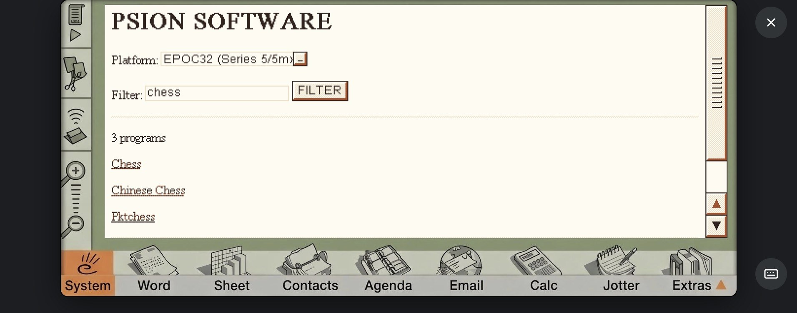

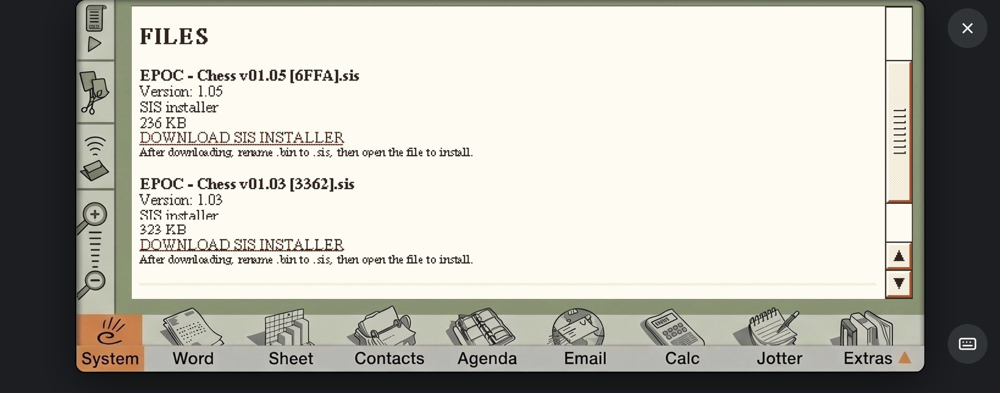

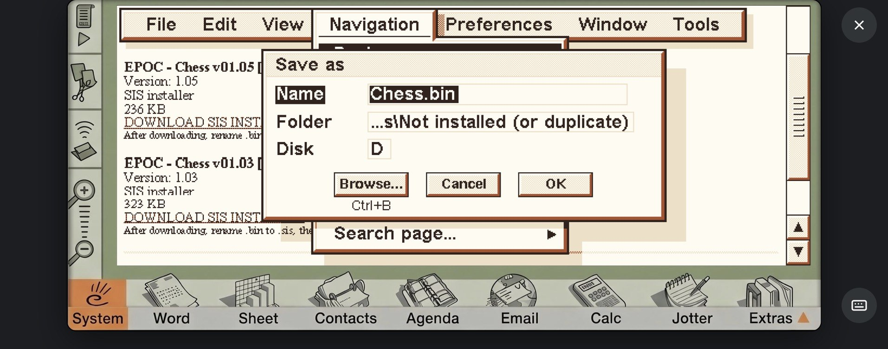

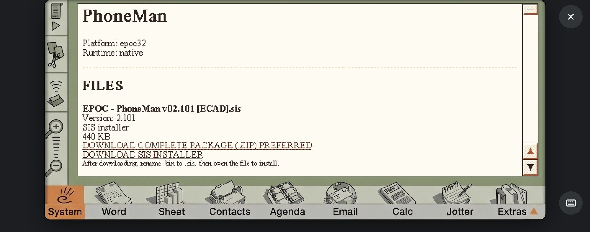

### Saving and installing software

The browser may initially use a generic filename such as `Download.bin`.
Follow the save prompt and check the resulting filename before attempting to
install the package. If an individual download is saved with a `.bin`
extension rather than its original extension, you may need to rename it.

A ZIP package may need to be extracted on a compatible computer or device
before its contents can be transferred to or used on the Psion. Do not assume
that the Psion itself can extract every ZIP archive.

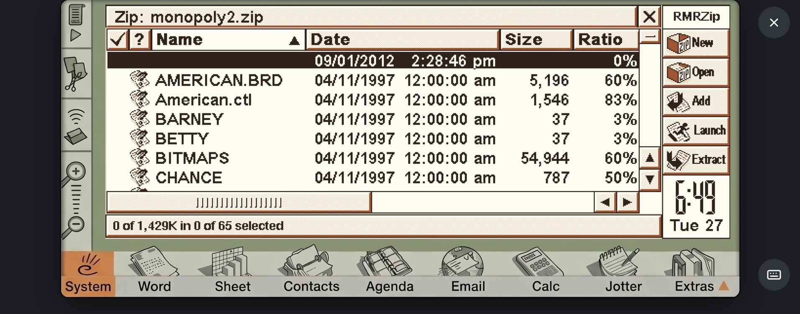

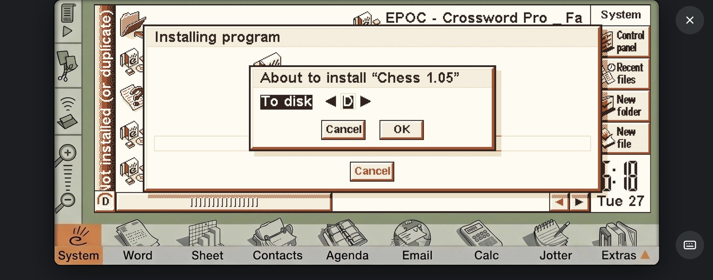

Software availability depends on the external archive and the links recorded
in the catalogue. Respect the copyright and redistribution terms for any
software you download.

## 4. Download a Guardian crossword

1. On the Sidecar homepage, choose the Quick or Cryptic crossword option.
2. Enter the crossword number and submit the request.
3. When the request completes, choose the version you need:
   - **Original** — the original text file, intended for conversion before use
     in a compatible RMR / FatCatz crossword application.
   - **RMR version** — converted by Sidecar on the Raspberry Pi and intended to
     be opened directly in a compatible RMR / FatCatz crossword application.
4. Select the download link and follow the browser's prompts to save the file
   on the Psion. You can also use the local archive to retrieve a crossword
   already stored on the Raspberry Pi.

Example original filenames include `Quick_17028.txt` and
`Cryptic_30103.txt`. The converted RMR file is labelled separately in the
Sidecar interface.

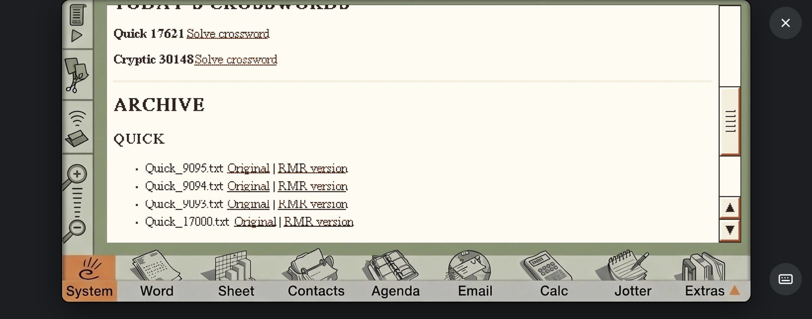

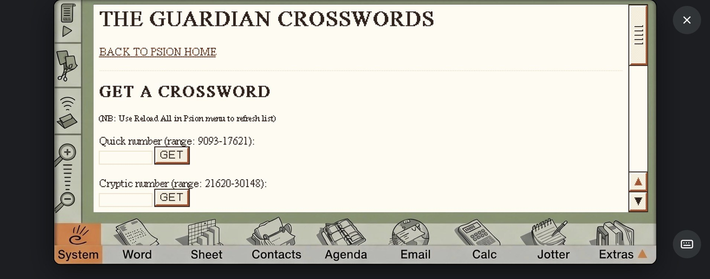

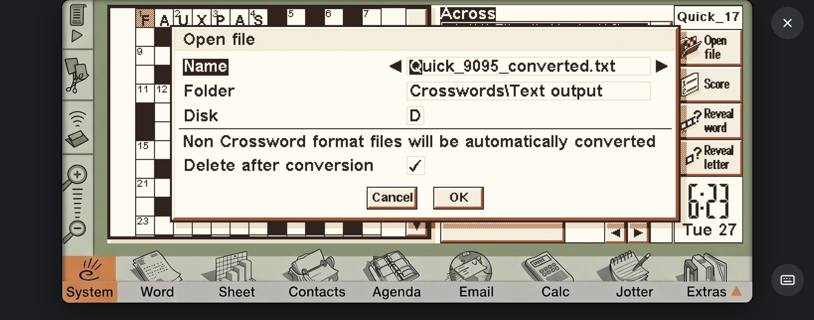

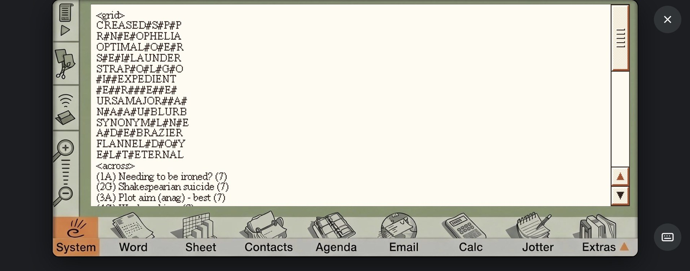

## 5. Open or convert the crossword on the Psion

### If you downloaded the RMR version

Open the downloaded converted file directly in a compatible RMR / FatCatz
crossword application. Use the application's **File → Open** command and
browse to the folder where you saved it.

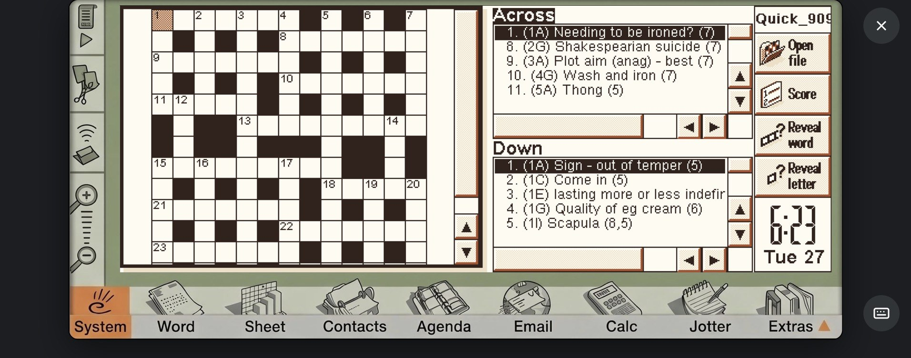

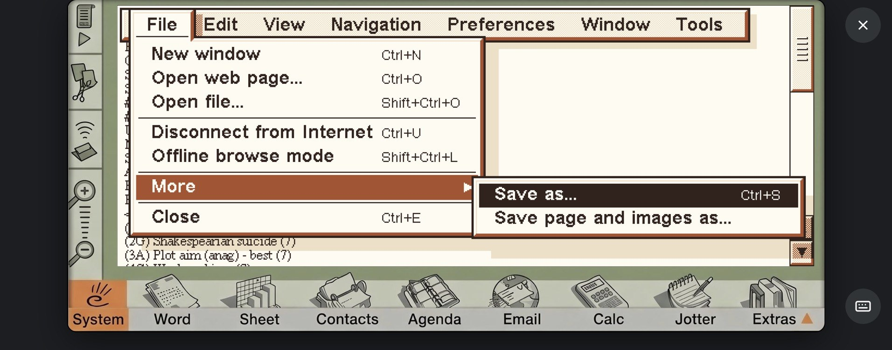

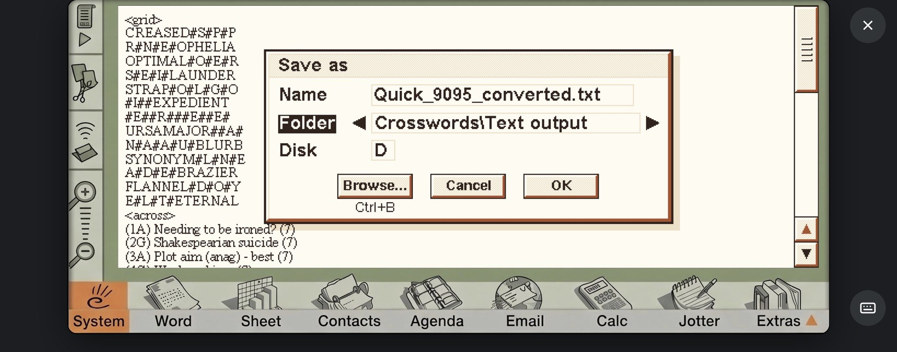

### If you downloaded the original text file

The original Guardian text file must be converted before it can be opened in
RMR / FatCatz Crossword.

1. Transfer the original text file to a location accessible on the Psion.
2. Open the separate OPL converter, `crossword_converter_v01.txt`, in your
   Psion OPL environment and save it as an `.opl` program if you have not
   already prepared it.
3. Run the converter and follow its prompts to select and convert the
   crossword text file.
4. Open the resulting converted crossword in RMR / FatCatz Crossword.

The screenshots below show the Psion-side import and conversion workflow.
This OPL process is separate from the conversion performed by Sidecar on the
Raspberry Pi.

## Notes

- The Sidecar server must be running for its browser interface to be available.
- The Raspberry Pi and Psion need a working network or other supported
  connection between them.
- Browser prompts and file-handling behaviour can vary by Psion model and
  browser version.
- The Guardian website and external software archives can change
  independently of the Sidecar project.
